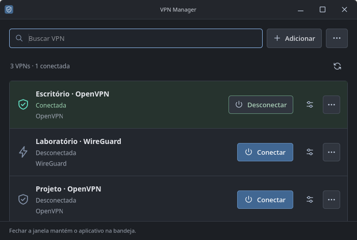

# VPN Manager

[Português](README.md) · **English**

**All your VPNs in one place, one click to connect.**

VPN Manager lists the VPNs on your computer, imports the configuration your company or provider sent you, and connects from its window or from the icon next to the clock. It never sends your data to any server, and passwords stay in your system's own keyring.

The app's interface is currently in Portuguese; this guide shows each Portuguese label followed by its English meaning.



[Download](#download-and-install) · [Getting started](#getting-started) · [Supported VPNs](#which-vpns-work) · [FAQ](#frequently-asked-questions) · [For developers](#for-developers)

## What it does

- **Connects in one click**, from the window or the tray icon.
- **Imports the configuration you received**: an `.ovpn` or `.conf` file, or your company's `.zip` bundle, even when it comes with install scripts. Scripts are only read, never run.
- **Brings in your FortiClient VPNs automatically**, including SSO login in the browser.
- **Remembers your password** safely in the system keyring, if you want it to.
- **Stays out of the way**: closing the window keeps it in the tray, and it can start with your computer.

## Download and install

Get the file for your system from the **[downloads page](https://github.com/joaogabriel15/vpn-manager/releases/latest)**.

| System | Download | How to install |
| --- | --- | --- |
| Ubuntu 24.04+, Debian 13+, Mint 22+ | `…-linux-x86_64.deb` | Double-click the file and choose **Install** |
| Fedora 40+, openSUSE | `…-linux-x86_64.rpm` | Double-click the file and choose **Install** |
| Arch, CachyOS and Manjaro | — | Use the `pacman` repository below |
| Other distributions | `…-linux-x86_64.tar.gz` | Extract it, open a terminal in the folder and run `./install.sh` |
| Windows 10 and 11 | `…-windows-x86_64.msi` | Double-click it and follow the installer |
| Mac with Apple chip (M1 or newer) | `…-macos-arm64.dmg` | Open it and drag **VPN Manager** to **Applications** |
| Mac with Intel processor | `…-macos-x86_64.dmg` | Same as above |

After installing, look for **VPN Manager** in your applications menu.

### Install from the terminal, with automatic updates

This way VPN Manager is updated together with the rest of your system.

**Ubuntu, Debian and Mint:**

```sh
curl -fsSL https://joaogabriel15.github.io/vpn-manager/vpn-manager.asc | sudo gpg --dearmor -o /usr/share/keyrings/vpn-manager.gpg
echo "deb [signed-by=/usr/share/keyrings/vpn-manager.gpg] https://joaogabriel15.github.io/vpn-manager/apt stable main" | sudo tee /etc/apt/sources.list.d/vpn-manager.list
sudo apt update && sudo apt install vpn-manager
```

**Fedora:**

```sh
sudo curl -fsSL -o /etc/yum.repos.d/vpn-manager.repo https://joaogabriel15.github.io/vpn-manager/vpn-manager.repo
sudo dnf install vpn-manager
```

**Arch, CachyOS and Manjaro:**

```sh
curl -fsSL https://joaogabriel15.github.io/vpn-manager/vpn-manager.asc | sudo pacman-key --add -
sudo pacman-key --lsign-key D3EF5AFE4AFEB7F8DAF3D5DCC0F57413B694E98A
printf '\n[vpn-manager]\nServer = https://joaogabriel15.github.io/vpn-manager/arch/$arch\n' | sudo tee -a /etc/pacman.conf
sudo pacman -Sy vpn-manager-bin
```

**openSUSE:**

```sh
sudo zypper addrepo https://joaogabriel15.github.io/vpn-manager/vpn-manager.repo
sudo zypper install vpn-manager
```

**Mac (Homebrew):**

```sh
brew install --cask joaogabriel15/tap/vpn-manager
```

**Windows (winget):** under review by Microsoft ([request](https://github.com/microsoft/winget-pkgs/pull/481248)). Once approved:

```powershell
winget install joaogabriel15.VPNManager
```

**To update later**, use your system's usual command: `sudo apt upgrade`, `sudo dnf upgrade`, `sudo pacman -Syu`, `sudo zypper update`, `brew upgrade` or `winget upgrade`. New VPN Manager versions arrive along with your system updates.

**Installed it before with `install.sh`?** Remove the old copy so the system uses the packaged one:

```sh
rm -f ~/.local/bin/vpn-manager ~/.local/bin/vpn-manager-cli ~/.local/share/applications/br.com.pacheco.VpnManager.desktop
```

**Warnings on first launch.** The app does not have a paid code signature yet, so your system may be cautious about it:

- **Windows:** on "Windows protected your PC", click **More info** and then **Run anyway**.
- **Mac:** if it says the developer cannot be verified, open **System Settings → Privacy & Security** and click **Open Anyway**.

## Getting started

### 1. Add your VPN

Click **Adicionar** (Add) and pick an option:

- **Importar arquivo…** (Import file): choose the file you received (`.ovpn`, `.conf`, `.zip` or `.tar.gz`). The app detects the type and asks before saving.
- **Importar do FortiClient…** (Import from FortiClient): brings in your FortiClient connections. Usually you don't even need to click it, because they are imported automatically when the app opens.
- **Criar OpenVPN…** (Create OpenVPN): fill in server, user and certificate if you don't have a file.
- **Outros protocolos…** (Other protocols): opens the system configurator for other VPN types.

VPNs that already exist on the computer show up in the list automatically.

### 2. Connect

Click **Conectar** (Connect). The first time, type your user and password. The app keeps the password in the system keyring for next time; tick **Usar senha somente desta vez** (Use this password only this time) if you'd rather not save it.

For Fortinet VPNs with SSO, the computer asks for your administrator password and the browser opens your company's login page. Sign in as usual; the VPN connects right after.

### 3. Use it from the tray

Closing the window doesn't turn anything off: the app stays in the icon next to the clock, where you can connect and disconnect each VPN. To start the app with your computer, open the **⋮** menu and tick **Iniciar com o Linux** (Start with Linux).

## Which VPNs work

| System | VPNs |
| --- | --- |
| **Linux** | OpenVPN, WireGuard, Fortinet SSL-VPN (including SSO), Cisco AnyConnect and compatible (OpenConnect), IKEv2/IPsec, L2TP, SSTP, legacy Cisco IPsec and others supported by NetworkManager |
| **Windows** | VPNs set up in **Settings → Network & Internet → VPN** (IKEv2, SSTP, L2TP and other built-in types) |
| **Mac** | VPNs set up in **System Settings → VPN** |

On Windows and Mac, the current version lists, connects and disconnects the VPNs you set up in the system. Importing files and connecting OpenVPN or WireGuard on these systems is still in development.

**Not** supported yet: MFA code login inside the app (except Fortinet SSO), closed clients that don't register with the system, mesh networks such as Tailscale and ZeroTier, and proxies.

## Frequently asked questions

**The app didn't recognize my file.**
It accepts OpenVPN, WireGuard, Cisco `.pcf`, and `.zip`/`.tar.gz` bundles containing one of those. If the bundle has more than one different VPN, extract it and import the right file. For other types, use **Adicionar → Outros protocolos…** (Add → Other protocols).

**I got "plugin not found" or "install the plugin".**
Linux needs the component for your VPN type. Install it from your app store or the terminal, for example:

- Ubuntu/Debian: `sudo apt install network-manager-openvpn`
- Fedora: `sudo dnf install NetworkManager-openvpn`
- Arch/CachyOS: `sudo pacman -S networkmanager-openvpn`

Replace `openvpn` with `openconnect`, `fortisslvpn`, `strongswan`, `l2tp` or `sstp` to match your VPN. For Fortinet with SSO, install the `openfortivpn` package.

**It asks for my password every time.**
Check that **Usar senha somente desta vez** is not ticked. On Linux, the password keyring must be running (KWallet on KDE or Keyring on GNOME). To change or forget the saved password, open the VPN's **⋯** menu and choose **Senha salva e login…** (Saved password and login).

**Does the VPN stay on after I close the app?**
Yes. Closing the window or quitting the app doesn't drop your VPNs, because the system keeps them. The exception is Fortinet with SSO, which the app runs itself: **Sair** (Quit) disconnects that VPN.

**I don't see the tray icon.**
On KDE it shows up right away. On GNOME, install the **AppIndicator** extension from the extensions store.

**I'm connected but can't reach company systems.**
Disconnect and reconnect after changing any setting. With **split tunneling**, only the configured networks go through the VPN. **⋮ → Diagnóstico de rede** (Network diagnostics) shows addresses, routes and DNS you can send to your IT team.

**Is my data safe?**
The app has no server of its own and sends nothing out. Passwords stay in the system keyring. Imported configurations never run scripts, and certificates stay on your computer.

## Uninstall

- **Ubuntu/Debian:** `sudo apt remove vpn-manager`, or from the app store.
- **Fedora:** `sudo dnf remove vpn-manager`.
- **Arch/CachyOS:** `sudo pacman -R vpn-manager-bin`.
- **Others (installed with `install.sh`):** delete `~/.local/bin/vpn-manager`, `~/.local/bin/vpn-manager-cli` and the shortcut `br.com.pacheco.VpnManager.desktop` in `~/.local/share/applications`.
- **Windows:** **Settings → Apps → VPN Manager → Uninstall**.
- **Mac:** drag **VPN Manager** from **Applications** to the Trash.

The VPNs set up in your system remain after removing the app.

## For developers

The technical documentation is in Portuguese:

- [Development and technical details](docs/DEVELOPMENT.md): building, architecture, command line, security and tests.
- [Linux VPN coverage](docs/LINUX-VPN-SUPPORT.md) and [compatibility inventory](docs/VPN-COMPATIBILITY.md).
- [Releases and packages](docs/DESKTOP-RELEASES.md), [validation](docs/VALIDATION.md), [roadmap](ROADMAP.md) and [backlog](BACKLOG.md).
- [Screenshot gallery](docs/screenshots/README.md), all with sample data.

## License

[MIT](LICENSE). Dependencies keep their own licenses, listed in the packages.
