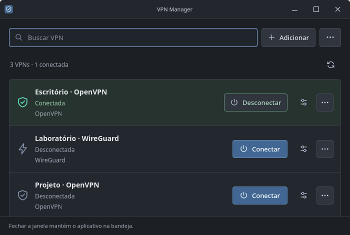
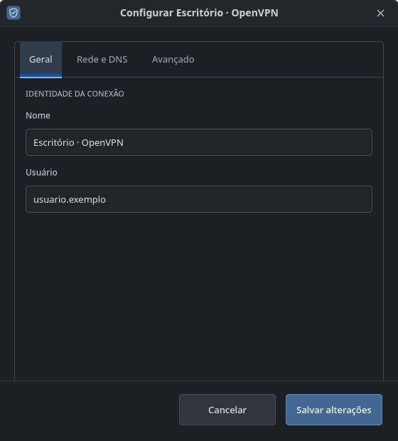
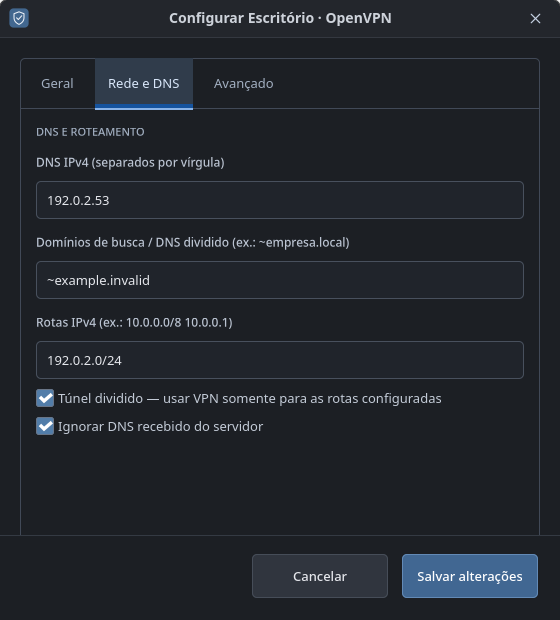
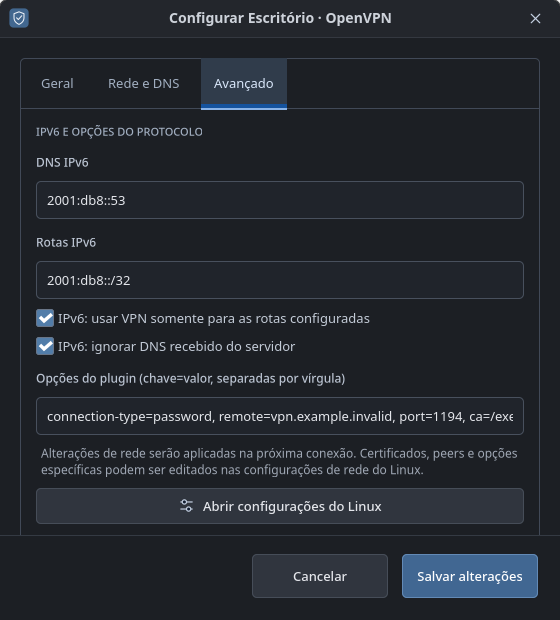
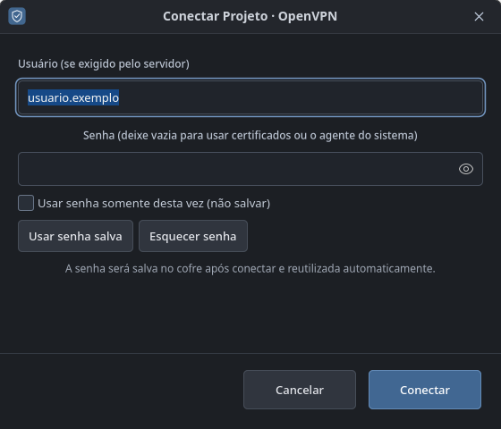

# VPN Manager

Gerenciador de VPN em Rust, com foco em **Linux, Windows e macOS**. Interface em português, busca de perfis e acesso pela bandeja.

Linux usa GTK 4 e NetworkManager, sem executar a interface como root. Windows e macOS têm implementação inicial com interface e CLI para VPNs cadastradas no sistema.

[Roadmap](ROADMAP.md) · [Releases desktop](docs/DESKTOP-RELEASES.md) · [Instalação Linux](#instalação) · [Validação](docs/VALIDATION.md) · [Backlog técnico](BACKLOG.md) · [Cobertura VPN no Linux](docs/LINUX-VPN-SUPPORT.md)

## Estado do projeto

| Plataforma | Situação |
| --- | --- |
| Linux | Aplicativo e CLI implementados; homologação completa em andamento |
| Windows x64 | Interface/CLI iniciais para perfis VPN nativos do usuário; pacote ZIP portátil; túneis reais ainda não homologados |
| macOS 13+ Intel/Apple Silicon | Interface/CLI iniciais para perfis expostos em `scutil --nc`; pacote `.app` em ZIP; túneis reais ainda não homologados |

Android e iOS/iPadOS ficam para uma fase futura. Os checks do núcleo Rust fora do Linux não equivalem a aplicativos prontos nessas plataformas.

## Releases e Windows/macOS

O workflow [Desktop releases](.github/workflows/release.yml) gera os quatro pacotes e checksums SHA-256. Cada push na `main` publica uma prerelease com tag única e vinculada ao commit após todos os builds passarem. Tags `v<versão do Cargo.toml>` também publicam; execução manual gera somente artefatos. Consulte [instalação, limites e publicação](docs/DESKTOP-RELEASES.md).

Windows/macOS permitem buscar e listar as VPNs do sistema, solicitar conexão/desligamento e abrir as configurações nativas. A atualização do estado é manual. Credenciais/certificados são configurados no sistema; engines OpenVPN/WireGuard, importação, bandeja, eventos e agente MFA nessas plataformas permanecem pendentes. Windows sem assinatura Authenticode; macOS com assinatura ad hoc, sem notarização. O workflow ainda precisa de execução remota observada; compilação local cruzada não homologa conectividade.

## Interface

Janela compacta com busca, lista de VPNs e botão Conectar. O menu Adicionar reúne a importação, a criação OpenVPN e o cadastro de outros protocolos pelo editor nativo; o menu do aplicativo reúne diagnóstico, início automático e saída. As configurações são organizadas nas abas Geral, Rede e DNS, e Avançado. Ícones SVG próprios, incorporados ao binário, mantêm a aparência consistente no app e na bandeja, independentemente do tema de ícones do Linux.

As imagens abaixo mostram o **aplicativo real com perfis fictícios**. Usuário, endereços e estado conectado são dados de demonstração; nenhum túnel foi ativado para as capturas.



<details>
<summary>Ver configurações e login</summary>

| Geral | Rede e DNS |
| --- | --- |
|  |  |

| Avançado | Login OpenVPN |
| --- | --- |
|  |  |

A [galeria completa](docs/screenshots/README.md) inclui o editor em largura reduzida e as instruções para reproduzir as capturas.

</details>

## Recursos disponíveis no Linux

- Descobre os perfis VPN e WireGuard existentes no NetworkManager.
- Busca, conexão, desconexão, duplicação e remoção com confirmação.
- Importa OpenVPN, WireGuard, Cisco PCF e configurações básicas VPN Manager TOML v2, identificando o conteúdo do arquivo. PCF é importado sem senhas.
- Cria OpenVPN com usuário/senha, CA, porta e UDP/TCP.
- Edita nome, usuário, opções do plugin, DNS IPv4/IPv6, domínios de busca, rotas e túnel dividido.
- Abre o editor do Linux para certificados, peers WireGuard e demais opções específicas do protocolo (KDE ou nm-connection-editor).
- Exporta perfis dos plugins VPN que oferecem exportação; o arquivo tem permissão 0600. WireGuard não possui exportação nesta versão.
- Catálogo de 12 famílias: OpenVPN, WireGuard, OpenConnect, Fortinet SSL, strongSwan, Libreswan, L2TP, SSTP, VPNC, PPTP, SSH e Iodine; plugins adicionais continuam visíveis. Cadastro específico pelo editor nativo conforme os plugins instalados.
- Diagnóstico com interfaces, endereços, rotas e DNS; consulta de engines, bibliotecas de configuração e diálogos de autenticação. Aviso de dependência ausente antes de conectar.
- Login interativo opcional por `nmcli --ask` no terminal, conforme os prompts oferecidos pelo plugin; sem promessa universal de MFA/SAML.
- Leitura dos estados de preparação, autenticação e falha da VPN pela API D-Bus, com atualização por eventos.
- Cancelamento de conexão e cofre para senhas OpenVPN, com salvamento padrão e opção explícita de uso único.
- Ícone na bandeja com atalhos por conexão. Fechar a janela mantém o app em segundo plano; Sair encerra somente o gerenciador.
- Inicialização opcional na bandeja ao entrar na sessão.

## Roadmap

O [roadmap do projeto](ROADMAP.md) separa o que já existe das implementações e validações pendentes:

1. Consolidar o núcleo compartilhado e concluir os fluxos Linux pelo aplicativo e NetworkManager.
2. Ampliar o Windows inicial com engines OpenVPN/WireGuard, serviço, cofre, bandeja e instalador.
3. Ampliar o macOS inicial com engines, cofre, eventos, menu e distribuição notarizada.
4. Ampliar protocolos e gateways, incluindo IKEv2 e cenários Fortinet separados, e publicar releases desktop homologadas.

O [backlog técnico](BACKLOG.md) mantém as dependências e os critérios de aceite. O [inventário de compatibilidade](docs/VPN-COMPATIBILITY.md) e o [plano de plataformas](docs/PLATFORMS.md) descrevem a expansão; planejamento não representa suporte já entregue.

## Instalação

Requisitos: Rust, GTK >= 4.12, NetworkManager/nmcli e o plugin de cada protocolo. KDE Plasma já oferece suporte à bandeja; GNOME pode exigir uma extensão AppIndicator. No CachyOS, os pacotes relevantes são `gtk4`, `networkmanager` e `networkmanager-openvpn`. O editor avançado usa `plasma-nm` ou `nm-connection-editor`.

```sh
cargo build --release --locked
./install.sh
~/.local/bin/vpn-manager
```

O instalador é por usuário, sem sudo, e cria entradas no menu e na área de trabalho. O arquivo `br.com.pacheco.VpnManager.desktop` corresponde ao identificador da janela no Wayland. No KDE, o instalador também atualiza o atalho antigo já fixado na barra, preservando os outros atalhos e sua ordem. Marque **Iniciar com o Linux** no menu do app para ativar o autostart. `vpn-manager --background` abre diretamente na bandeja. Se a bandeja não estiver disponível, a janela aparece.

Para atualizar, recompile e execute o instalador novamente. O script reutiliza o binário já compilado. Os perfis são mantidos pelo NetworkManager e não são apagados ao remover o app.

## Uso

Clique em **Conectar** ou no nome da conexão no menu da bandeja. Para perfis OpenVPN, a senha é salva no cofre por padrão após conectar com sucesso. Marque **Usar senha somente desta vez (não salvar)** quando não quiser guardá-la. Depois de uma conexão bem-sucedida, os próximos cliques em Conectar usam a senha do cofre, sem abrir o formulário. **Senha salva e login…** no menu do perfil permite trocar ou esquecer a senha. Deixe a senha vazia quando o perfil usa certificados ou credenciais já disponíveis no cofre do sistema. Para desafios específicos, use o agente de segredos do ambiente Linux ou **Login interativo no terminal** no menu do perfil. O suporte depende do plugin; o app não implementa um agente próprio nem garante todo MFA/SAML.

Alterações de DNS e rotas entram em vigor ao reconectar. Túnel dividido impede a rota padrão pela VPN; configure as redes corporativas necessárias. O app não cria kill switch nem firewall e não promete bloquear tráfego quando a VPN cai. A inicialização automática inicia o gerenciador, não estabelece uma VPN automaticamente.

Na importação e exportação, certificados e chaves podem permanecer em arquivos externos referenciados pelo perfil. Preserve os arquivos e não compartilhe exportações sem revisar o conteúdo. O formato exportado depende do plugin instalado.

## Arquitetura e consumo

GTK desenha sob demanda. Um único `nmcli monitor` aguarda eventos de rede, complementado pelo sinal D-Bus de estado específico da VPN; não há consultas periódicas ou renderização contínua. Comandos são assíncronos pelo GIO, sem bloquear a interface. O NetworkManager mantém o túnel mesmo quando o gerenciador é encerrado.

O workspace separa o app desktop (GTK no Linux; eframe/egui no Windows/macOS), `crates/vpn-manager-native` (adaptadores Windows/macOS), `crates/vpn-manager-core` (modelos, estados, contrato inicial, detecção de importação e referências versionadas) e `crates/vpn-manager-networkmanager` (adaptador Linux com GIO, sem GTK). O contrato cobre gestão, conexão, cancelamento, descoberta e eventos; o backend Linux mantém a execução de comandos e o monitor. Consulte [as notas de retomada](docs/RETOMADA.md) para os limites atuais.

Uma CLI sem GTK está disponível com `cargo build -p vpn-manager-networkmanager --release --locked`. Consulte `./target/release/vpn-manager-cli --help`. Ela requer NetworkManager e usa o agente de segredos do sistema. Oferece `list`, `connect <uuid>`, `disconnect <uuid>`, `save-reference <uuid> <arquivo.toml>` e `connect-reference <arquivo.toml>`. Referências TOML v1 são migradas para v2 sem mudar o identificador. A v2 também aceita configurações básicas OpenVPN e opções IPv4/IPv6, sem senhas ou chaves privadas. Consulte o [exemplo](docs/examples/openvpn-profile.toml). `validate-profile <arquivo.toml>` valida o documento; `create-profile <arquivo.toml>` cria sem conectar e remove o perfil novo se a aplicação da rede falhar. `capabilities` lista plugins; `cancel <uuid>` solicita o desligamento de uma tentativa ativa. `catalog`, `import`, `validate-import`, `export`, `edit`, `create-native` e `connect <uuid> --ask` ampliam a gestão Linux; veja [os fluxos e limites por protocolo](docs/LINUX-VPN-SUPPORT.md). Referências são salvas com permissão 0600 e sem sobrescrever arquivos existentes.

A importação identifica OpenVPN, WireGuard, Cisco PCF e documentos VPN Manager pelo conteúdo, independentemente da extensão. Arquivos desconhecidos ou ambíguos e hooks executáveis são rejeitados. Senhas de PCF são descartadas antes de chamar o plugin. O formulário de senha do app é específico para OpenVPN; outros plugins usam o agente do sistema ou o login interativo opcional por terminal. O editor mantém as opções de DNS e túnel dividido de IPv4 e IPv6 separadas.

Senhas não são enviadas como argumentos de processo. No Linux, o nmcli recebe a senha OpenVPN por um descritor herdado de arquivo anônimo 0600, sem arquivo nomeado que possa ficar abandonado após uma queda da GUI. O cliente mantém o descritor até encerrar; o timeout da ativação é de 40 segundos. Os buffers próprios usam limpeza de memória ao descartar; GTK/GIO e as engines também mantêm seus próprios buffers.

O salvamento no cofre é o padrão quando ele está disponível, sempre após sucesso. A opção **Usar senha somente desta vez (não salvar)** inicia desmarcada e impede gravar ou substituir a senha naquela tentativa. A senha é reutilizada automaticamente por perfil e usuário; se o cofre estiver indisponível ou a tentativa falhar, o formulário permite informar uma nova senha. **Usar senha salva** e **Esquecer senha** acessam o Secret Service por `secret-tool` (libsecret); instale a ferramenta e configure um provedor de cofre compatível. Os itens são separados por perfil e usuário. Para outros plugins, **Salvar credenciais no sistema…** abre o editor nativo, usando as opções de armazenamento próprias do plugin/agente. Sem essa ferramenta, o login manual e o agente do sistema continuam disponíveis. O app não implementa desafios MFA/SAML nem um agente de segredos próprio. Perfis e certificados continuam sob controle do NetworkManager. Autorizações seguem as regras Polkit do sistema; o app não contorna permissões administrativas.

## Verificação

```sh
cargo test --workspace --locked
# Integração: cria e remove perfis temporários, sem conectar.
cargo test --workspace --locked -- --include-ignored
cargo clippy --workspace --all-targets --locked -- -D warnings
# Integração dos estados e sinais em D-Bus privado (requer Python/PyGObject e dbus-daemon).
python3 tests/states.py
cargo build --release --locked
# GUI com senha fictícia: verifica uso único sem salvar, salvamento padrão e reconexão sem redigitar; não acessa cofre/túnel reais.
python3 tests/saved-login.py
# Requer sessão gráfica e NetworkManager; consulta perfis e cancela o editor.
./target/release/vpn-manager --self-test
```

Para reproduzir as capturas publicáveis com dados fictícios, execute `python3 tests/screenshots.py` após compilar. Para uma captura local dos perfis reais, existe `VPN_MANAGER_PREVIEW=/tmp/vpn-manager.png ./target/release/vpn-manager --self-test`; revise o conteúdo antes de compartilhar. O teste também verifica o menu de ações, a busca, os ícones da bandeja, as abas do editor e o cancelamento do formulário OpenVPN, sem acessar o cofre ou conectar.

O teste gráfico executa uma instância separada, sem encerrar o app já aberto. Não conecta, remove ou altera perfis. A conexão real exige credenciais e acesso ao servidor.

## Remover

Desmarque o início automático no app, saia e remova `~/.local/bin/vpn-manager`, os arquivos `br.com.pacheco.VpnManager.desktop` e `vpn-manager.desktop` do menu/área de trabalho, `~/.local/bin/vpn-manager-cli` se instalado e o ícone instalado em `~/.local/share/icons/hicolor/scalable/apps/`. Os perfis VPN são preservados.

O laboratório de engines está em `tests/lab/run.py`; a medição de repouso está em `tests/measure-idle.py`. Veja os [resultados e limites da validação](docs/VALIDATION.md).

Referências técnicas: [GTK para Rust](https://gtk-rs.org/gtk4-rs/stable/latest/docs/gtk4/), [ksni](https://docs.rs/ksni/latest/ksni/), [nmcli](https://networkmanager.dev/docs/api/latest/nmcli.html).
