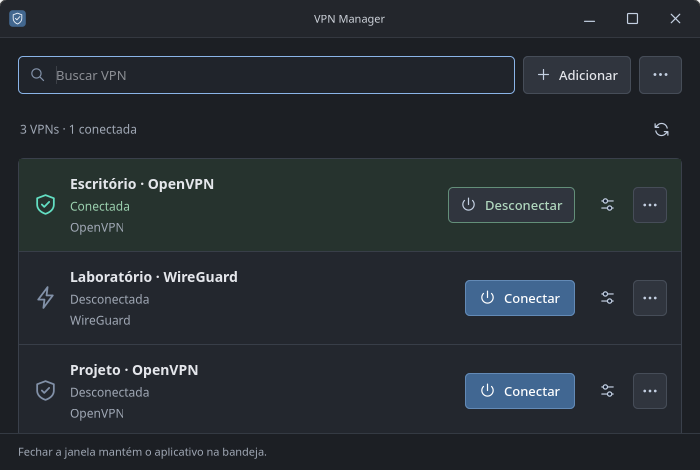

# VPN Manager

**Todas as suas VPNs em um só lugar, em português e com um clique para conectar.**

O VPN Manager lista as VPNs do computador, importa as configurações que a sua empresa ou provedor enviou e conecta pela janela ou pelo ícone perto do relógio. Ele não envia seus dados para nenhum servidor e guarda as senhas no cofre do próprio sistema.



[Baixar](#baixar-e-instalar) · [Primeiros passos](#primeiros-passos) · [VPNs compatíveis](#quais-vpns-funcionam) · [Dúvidas](#dúvidas-frequentes) · [Para desenvolvedores](#para-desenvolvedores)

## O que ele faz

- **Conecta com um clique**, pela janela ou pelo ícone da bandeja.
- **Importa a configuração que você recebeu**: arquivo `.ovpn` ou `.conf`, ou o pacote `.zip` da empresa, mesmo que venha com scripts de instalação. Os scripts são só lidos, nunca executados.
- **Traz suas VPNs do FortiClient sozinho**, incluindo login SSO pelo navegador.
- **Lembra a senha** com segurança, no cofre do sistema, se você quiser.
- **Fica discreto**: fechar a janela deixa o app na bandeja, e ele pode iniciar junto com o computador.

## Baixar e instalar

Baixe o arquivo do seu sistema na **[página de downloads](https://github.com/joaogabriel15/vpn-manager/releases/latest)**.

| Sistema | Baixe | Como instalar |
| --- | --- | --- |
| Ubuntu 24.04+, Debian 13+, Mint 22+ | `…-linux-x86_64.deb` | Dê dois cliques no arquivo e clique em **Instalar** |
| Fedora 40+, openSUSE | `…-linux-x86_64.rpm` | Dê dois cliques no arquivo e clique em **Instalar** |
| Arch, CachyOS e Manjaro | — | Use o repositório `pacman` abaixo |
| Outras distribuições | `…-linux-x86_64.tar.gz` | Extraia, abra um terminal na pasta e rode `./install.sh` |
| Windows 10 e 11 | `…-windows-x86_64.msi` | Dê dois cliques e siga o instalador |
| Mac com chip Apple (M1 ou mais novo) | `…-macos-arm64.dmg` | Abra o arquivo e arraste **VPN Manager** para **Aplicativos** |
| Mac com processador Intel | `…-macos-x86_64.dmg` | Igual ao anterior |

Depois de instalar, procure **VPN Manager** no menu de aplicativos.

### Instalar pelo terminal, com atualizações automáticas

Assim o VPN Manager é atualizado junto com o resto do sistema.

**Ubuntu, Debian e Mint:**

```sh
curl -fsSL https://joaogabriel15.github.io/vpn-manager/vpn-manager.asc | sudo gpg --dearmor -o /usr/share/keyrings/vpn-manager.gpg
echo "deb [signed-by=/usr/share/keyrings/vpn-manager.gpg] https://joaogabriel15.github.io/vpn-manager/apt stable main" | sudo tee /etc/apt/sources.list.d/vpn-manager.list
sudo apt update && sudo apt install vpn-manager
```

**Fedora:**

```sh
sudo curl -fsSL -o /etc/yum.repos.d/vpn-manager.repo https://joaogabriel15.github.io/vpn-manager/vpn-manager.repo
sudo dnf install vpn-manager
```

**Arch, CachyOS e Manjaro:**

```sh
curl -fsSL https://joaogabriel15.github.io/vpn-manager/vpn-manager.asc | sudo pacman-key --add -
sudo pacman-key --lsign-key D3EF5AFE4AFEB7F8DAF3D5DCC0F57413B694E98A
printf '\n[vpn-manager]\nServer = https://joaogabriel15.github.io/vpn-manager/arch/$arch\n' | sudo tee -a /etc/pacman.conf
sudo pacman -Sy vpn-manager-bin
```

**openSUSE:**

```sh
sudo zypper addrepo https://joaogabriel15.github.io/vpn-manager/vpn-manager.repo
sudo zypper install vpn-manager
```

**Para atualizar depois**, use o comando de sempre do seu sistema: `sudo apt upgrade`, `sudo dnf upgrade`, `sudo pacman -Syu` ou `sudo zypper update`. As versões novas do VPN Manager chegam junto com as do sistema.

**Já instalou antes pelo `install.sh`?** Apague a cópia antiga para o sistema usar a do pacote:

```sh
rm -f ~/.local/bin/vpn-manager ~/.local/bin/vpn-manager-cli ~/.local/share/applications/br.com.pacheco.VpnManager.desktop
```

**Avisos na primeira abertura.** O app ainda não tem assinatura digital paga, então o sistema pode desconfiar dele:

- **Windows:** em "O Windows protegeu o computador", clique em **Mais informações** e depois em **Executar assim mesmo**.
- **Mac:** se aparecer que o desenvolvedor não pode ser verificado, abra **Ajustes do Sistema → Privacidade e Segurança** e clique em **Abrir Mesmo Assim**.

## Primeiros passos

### 1. Adicione sua VPN

Clique em **Adicionar** e escolha uma das opções:

- **Importar arquivo…**: selecione o arquivo que você recebeu (`.ovpn`, `.conf`, `.zip` ou `.tar.gz`). O app identifica o tipo sozinho e pede confirmação antes de salvar.
- **Importar do FortiClient…**: traz as conexões do FortiClient. Normalmente nem é preciso clicar, porque ao abrir o app elas já são importadas sozinhas.
- **Criar OpenVPN…**: preencha servidor, usuário e certificado se você não tem arquivo.
- **Outros protocolos…**: abre o configurador do sistema para outros tipos de VPN.

VPNs que já existiam no computador aparecem na lista automaticamente.

### 2. Conecte

Clique em **Conectar**. Na primeira vez, digite usuário e senha. O app guarda a senha no cofre do sistema para as próximas vezes, e você pode marcar **Usar senha somente desta vez** se preferir não salvar.

Nas VPNs da Fortinet com SSO, o computador pede a senha de administrador e o navegador abre o login da sua empresa. Faça o login normalmente; a VPN conecta sozinha em seguida.

### 3. Use pela bandeja

Fechar a janela não desliga nada: o app continua no ícone perto do relógio, de onde você conecta e desconecta cada VPN. Para iniciar o app junto com o computador, abra o menu **⋮** e marque **Iniciar com o Linux**.

## Quais VPNs funcionam

| Sistema | VPNs |
| --- | --- |
| **Linux** | OpenVPN, WireGuard, Fortinet SSL-VPN (inclusive com SSO), Cisco AnyConnect e compatíveis (OpenConnect), IKEv2/IPsec, L2TP, SSTP, Cisco IPsec legado e outras que o NetworkManager suporta |
| **Windows** | As VPNs cadastradas em **Configurações → Rede e Internet → VPN** (IKEv2, SSTP, L2TP e outras do sistema) |
| **Mac** | As VPNs cadastradas em **Ajustes do Sistema → VPN** |

No Windows e no Mac, a versão atual lista, conecta e desconecta as VPNs que você cadastrou no sistema. Importar arquivos e conectar OpenVPN ou WireGuard nesses sistemas ainda está em desenvolvimento.

Ainda **não** são suportados: login com código MFA dentro do app (exceto o SSO da Fortinet), clientes fechados que não se registram no sistema, redes mesh como Tailscale e ZeroTier, e proxies.

## Dúvidas frequentes

**O app não reconheceu meu arquivo.**
Ele aceita OpenVPN, WireGuard, Cisco `.pcf` e pacotes `.zip`/`.tar.gz` que contenham um desses. Se o pacote tiver mais de uma VPN diferente, extraia e importe o arquivo certo. Para outros tipos, use **Adicionar → Outros protocolos…**.

**Apareceu "plugin não encontrado" ou "instale o plugin".**
O Linux precisa do componente do tipo da sua VPN. Instale pela loja de aplicativos ou pelo terminal, por exemplo:

- Ubuntu/Debian: `sudo apt install network-manager-openvpn`
- Fedora: `sudo dnf install NetworkManager-openvpn`
- Arch/CachyOS: `sudo pacman -S networkmanager-openvpn`

Troque `openvpn` por `openconnect`, `fortisslvpn`, `strongswan`, `l2tp` ou `sstp` conforme a sua VPN. Para Fortinet com SSO, instale o pacote `openfortivpn`.

**Ele pede a senha toda vez.**
Confira se você não marcou **Usar senha somente desta vez**. No Linux, o cofre de senhas precisa estar ativo (KWallet no KDE ou Chaveiro no GNOME). Para trocar ou apagar a senha salva, abra o menu **⋯** da VPN e escolha **Senha salva e login…**.

**A VPN continua ligada depois que fecho o app?**
Sim. Fechar a janela ou sair do app não derruba as VPNs, porque quem as mantém é o sistema. A exceção é a Fortinet com SSO, que é mantida pelo próprio app: **Sair** desconecta essa VPN.

**Não vejo o ícone na bandeja.**
No KDE ele aparece direto. No GNOME, instale a extensão **AppIndicator** pela loja de extensões.

**Conectou, mas não acesso os sistemas da empresa.**
Desconecte e conecte de novo depois de mudar qualquer configuração. Se usa **túnel dividido**, só as redes configuradas passam pela VPN. Em **⋮ → Diagnóstico de rede** você vê endereços, rotas e DNS para enviar à equipe de TI.

**Meus dados ficam seguros?**
O app não tem servidor próprio e não envia nada para fora. As senhas ficam no cofre do sistema. Configurações importadas não executam scripts, e certificados ficam só no seu computador.

## Remover

- **Ubuntu/Debian:** `sudo apt remove vpn-manager`, ou pela loja de aplicativos.
- **Fedora:** `sudo dnf remove vpn-manager`.
- **Arch/CachyOS:** `sudo pacman -R vpn-manager-bin`.
- **Outras (instalado pelo `install.sh`):** apague `~/.local/bin/vpn-manager` e `~/.local/bin/vpn-manager-cli` e o atalho `br.com.pacheco.VpnManager.desktop` em `~/.local/share/applications`.
- **Windows:** **Configurações → Aplicativos → VPN Manager → Desinstalar**.
- **Mac:** arraste **VPN Manager** de **Aplicativos** para o Lixo.

Suas VPNs cadastradas no sistema continuam lá depois de remover o app.

## Para desenvolvedores

- [Desenvolvimento e detalhes técnicos](docs/DEVELOPMENT.md): compilar, arquitetura, linha de comando, segurança e testes.
- [Cobertura de VPN no Linux](docs/LINUX-VPN-SUPPORT.md) e [inventário de compatibilidade](docs/VPN-COMPATIBILITY.md).
- [Releases e pacotes](docs/DESKTOP-RELEASES.md), [validação](docs/VALIDATION.md), [roadmap](ROADMAP.md) e [backlog](BACKLOG.md).
- [Galeria de capturas](docs/screenshots/README.md), todas com dados fictícios.

## Licença

[MIT](LICENSE). Dependências mantêm suas próprias licenças, listadas nos pacotes.
